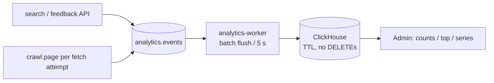

# Analytics pipeline

Server-side analytics: `API -> analytics.events (Kafka) -> analytics-worker
-> ClickHouse`. User-side (`client.*`) events are reserved for the future
track and rejected fail-closed until it ships.

## Why ClickHouse, why separate

The v0.4.33-v0.4.35 incident chain was write contention on the primary
Postgres (eviction UPDATEs stalling the crawler fleet, 19 s status reads).
Analytics is pure append volume — putting it in the same database would
recreate exactly that load pattern. So analytics lives in its own
ClickHouse database (`openlens_analytics`):

- Columnar MergeTree fits append-only event streams better than row-store
  bloat plus scheduled DELETEs.
- Native `TTL at + INTERVAL <retention_days> DAY` owns expiry — retention
  costs zero DELETE traffic. The worker's explicit purge is a belt-and-
  braces same-day enforcement.
- The API path only ever publishes (fire-and-forget, `linger_ms` batching);
  a sick broker or store degrades to dropped events, never a 500 on search
  or feedback. Analytics is at-most-once by design.

Postgres was deliberately not reused. Revisit only behind measured pain:
sustained inserts >~10k/sec, or dashboards routinely scanning >100M rows.
The Kafka topic decouples producers, so a future engine swap needs no
re-instrumentation.

## Flow

## Events

Closed allowlist in `src/openlens/analytics/events.py` — unknown names,
non-`server` sources, and oversized props are dropped, never stored:

| name | props | producer |
|---|---|---|
| `search.served` | `query_hash`, `mode`, `result_count` | API per search |
| `search.feedback` | `doc_id`, `action`, `reason?` | API per feedback tally |
| `crawl.page` | `url`, `outcome`, `domain`, `reason?` | worker per processed page |

Raw query text is never stored — only its SHA-256 hex digest. Crawled
page URLs are stored (like feedback `doc_id`) with only the outcome
(`fetched` / `failed` / `skipped`) and the short terminal reason
alongside. No identity, sessions, cookies, or IPs. When the user-side
track ships, add `client.*` names to the allowlist with their own prop
caps, plus a `source: server\|client` split so the firehose can be
routed/sampled separately.

`crawl.page` is the crawler's only analytics responsibility: one
fire-and-forget event per fetch *attempt* (including retries),
emitted through the same `analytics.events` queue. Dashboard counts
therefore track attempts, not distinct URLs — per-URL truth lives
in the store-backed failed list. Workers never aggregate — the admin
`GET /api/v1/admin/analytics/top?name=crawl.page&prop=reason` endpoint
(and the Analytics tab's Crawler card) does the counting. `top` also
accepts `filter_prop` + `filter_value` to restrict rows first (e.g.
`prop=domain&filter_prop=outcome&filter_value=failed` for top failing
domains), and `GET /api/v1/admin/analytics/series?name=&bucket=hour|day&days=`
returns per-bucket page counts (throughput) oldest-first. The Crawler
card combines these into outcome split, success rate, hourly/daily
throughput sparkline, domain split, top failing domains, and top
reasons.

## Services

- `clickhouse` (compose): `clickhouse/clickhouse-server:24.12-alpine`,
  ports 8123/9000 on localhost, volume `clickhouse-data`, user/db from
  `CLICKHOUSE_*` env.
- `analytics-worker` (compose): `python -m openlens.cli analytics-worker`,
  single replica on the `analytics` consumer group. Batch flush every
  `--batch-size` events or 5 s; offsets commit only after the store flush,
  so restarts replay uncommitted events (redeliveries are idempotent
  inserts, not deduped — counts tolerate replays).
- Backend publishes on every search (`served`) and feedback tally.
  Crawl workers publish one `crawl.page` event per processed page
  (fetched/failed/skipped + reason). The admin API serves
  `GET /api/v1/admin/analytics/counts?days=N`,
  `GET /api/v1/admin/analytics/top?name=&prop=&days=` (plus optional
  `filter_prop=`/`filter_value=`), and
  `GET /api/v1/admin/analytics/series?name=&bucket=&days=` (admin-gated,
  503 when the store is unreachable, 422 for unknown names/props).

## Operations

- Retention: `OPENLENS_ANALYTICS_RETENTION_DAYS` (default 90). Changing it
  issues `MODIFY TTL` on worker boot — no migration needed.
- Backfill/purge: the worker purges hourly; `counts_by_name` powers the
  admin endpoint.
- Local dev/tests: default backend is SQLite (`:memory:`/file), so boot
  works with no services. Compose sets
  `OPENLENS_ANALYTICS_BACKEND=clickhouse`.
- New event: add the name + prop keys to `EVENT_NAMES`/`EVENT_PROPS`,
  add a builder, cover it in `tests/unit/test_analytics.py`. No schema
  migration — props are a JSON string column.
