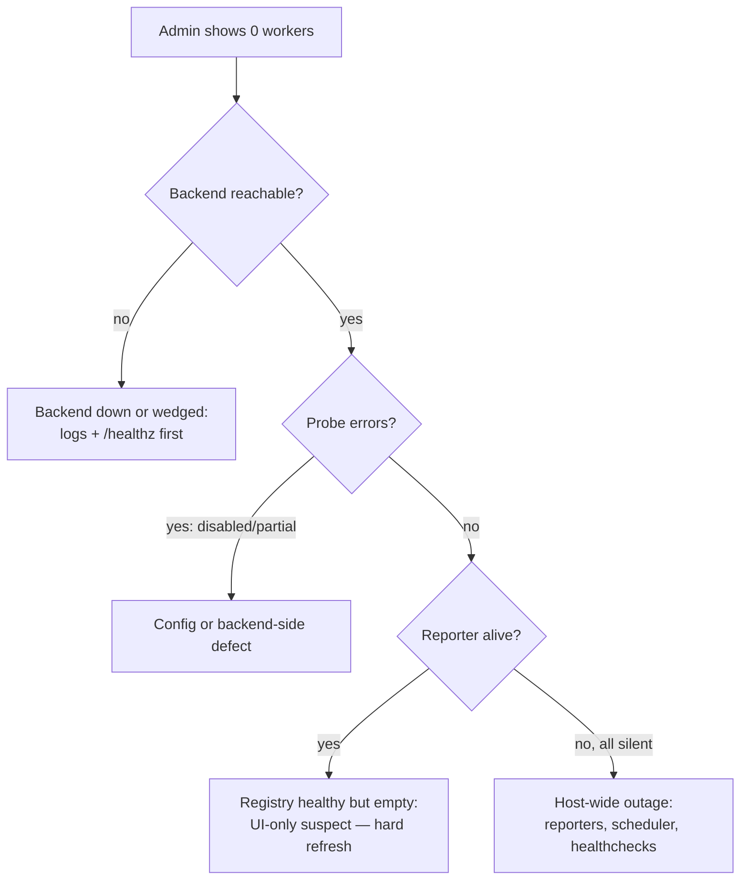

# Crawler fleet crawling but admin shows zero workers (idle heartbeat gap)

Date: 2026-11-01 · Fixed in v0.4.33

## Symptoms

- `GET /api/v1/frontier/workers` returns `{"workers": [], "worker_count": 0}`
  ("No workers heartbeating") while crawler containers are up and healthy.
- `frontier/status` shows `checkpoint: {phase: running, pages_attempted: 0,
  pages_indexed: 0}`, `claimed: 0`, `stats: null`, `kafka_lag_total: null`
  — yet the queue is churning (`done`/`skipped` counts grow between polls).
- Worker heartbeats briefly appear after a container restart, then vanish.
- Per-worker crawler logs show only the startup banner
  (`crawl=default queue=kafka ...`); `cat /proc/1/wchan` reads `do_sys_poll`;
  the process holds only internal sockets (Postgres + one half-closed Kafka).
- Admin token hashes match on backend, crawler, and `.env` (rules out 403s).
- Postgres is healthy: connections below max, zero ungranted locks, WAL
  sender the only active query.

## Root cause

Two independent facts combined into one misleading picture:

1. **Checkpoint only persists at pass end.** `pages_attempted/pages_indexed`
   stay 0 for the whole pass, so a running checkpoint with zeros does not
   mean "stuck" — compare `frontier_queue` status counts over time instead.
2. **The Kafka consumer's idle branch never beat.** When the topic is empty,
   `run_kafka_worker` sat in `poll()` and only ran the silent periodic DB
   backlog drain (`_drain_once`) — the progress heartbeat was sent only after
   consumed Kafka messages. With an empty topic the only beats a worker ever
   sent were the two forced startup ones; once the registry TTL expired,
   live mid-pass workers were pruned and the admin screen read zero.

## Fix (v0.4.33)

`src/openlens/indexing/worker.py`: after every periodic idle drain the
worker sends its progress heartbeat (claimed + cumulative pages/tokens/
errors + pages/min + tokens/min), wrapped in `contextlib.suppress` like the
drain itself so a transient API error can never kill the poll loop.

Regression test: `test_run_kafka_worker_idle_drain_sends_heartbeat` in
`tests/unit/test_kafka_queue.py` — an empty topic over
`_IDLE_DRAIN_EVERY_POLLS + 5` polls must produce ≥ 3 beats
(2 startup + 1 idle-drain).

## How to confirm on prod

1. Deploy the release, restart all crawler containers, then
   `POST /api/v1/frontier/resume` once with the admin token.
2. Within ~2 poll intervals (80 s) workers reappear in
   `GET /api/v1/frontier/workers` with `stats`, `pages_per_min`, and
   `tokens_per_min` populated — with no queue change.
3. `SELECT status, COUNT(*) FROM frontier_queue GROUP BY 1;` keeps moving
   within 5 minutes (`done` growing closes the incident).

## Do not chase these (ruled out for this signature)

- 403 heartbeat auth failures (compare token hashes first).
- Postgres saturation (check `pg_stat_activity` count vs `max_connections`,
  ungranted locks, prepared transactions).
- Kafka consumer-group lag (means nothing when the topic itself is empty).
- `documents` count frozen (expected until the pass-end checkpoint write).
