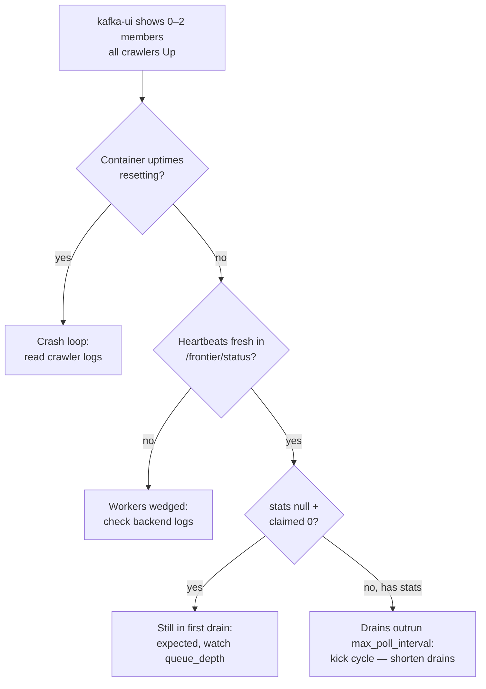

# Kafka group shows fewer members than crawler containers

Date: 2026-11-02 · Behavior as designed; burn-rate fixes in v0.4.47
(follows
[dashboard-lag-disabled-zero-workers-drain](dashboard-lag-disabled-zero-workers-drain.md))

## Symptoms

- kafka-ui (or `kafka-consumer-groups.sh --describe --group crawlers`)
  reports 2, 1, or 0 members for topic `crawl.urls` while all 6
  `crawler` containers are `Up` and healthy.
- The member count flaps between checks (2 → 0 → 2) instead of
  holding steady.
- Crawler logs show only the startup banner
  (`crawl=default queue=kafka ... seeds=0`); heartbeats keep landing
  (dashboard lists all 6 workers alive, some with `stats: null`).
- `kafka_lag_total` holds or grows (~1,100 per partition) while
  membership reads empty.

## Root cause

Membership follows the poll loop, and the poll loop comes last.
`run_kafka_worker` prints its banner, then runs the blocking
store-backlog `_drain_once()` (up to `max_pages` fetches serially —
20+ minutes against hostile domains at ~5–13 s per attempt), and
only then enters `while True: kafka.poll()`. A Kafka consumer joins
its group on the first poll, so **zero members during a deep initial
drain is expected**, not a broker or config failure.

The flapping has a second, compounding cause: `max_poll_interval_ms`
(900 s). Any drain that runs longer than 15 minutes without a poll
— the first drain, or an idle-cadence backlog drain (chunk 500) —
gets the member kicked; it rejoins on its next poll after the drain
returns. Slow drains therefore read as 0–2 members indefinitely.
Three brokers are not the cause: publishes flow, lag probes read,
and 12 partitions could host all 6 workers.

## How to confirm on prod

1. `docker logs openlens-local-crawler-<n>` shows only the startup
   banner — consistent with a blocking drain (nothing prints until
   it returns), not a crash (uptime would reset).
2. `GET /api/v1/frontier/status`: all workers `alive` with fresh
   `last_seen`; `claimed: 0`, `stats: null` on workers that have not
   finished a pass yet (stats report only after a completed pass).
3. `docker stats`: crawlers at low-but-nonzero CPU with growing
   NET I/O — working through fetches, not deadlocked. Flat
   `queue_depth` over minutes against a 100k backlog is the same
   signature at this fetch latency.
4. `kafka-consumer-groups.sh --describe --group crawlers` sampled
   3× over 10 minutes flaps instead of holding at 0 — joins happen,
   kicks undo them.

## Fix direction (v0.4.47 shrinks the drain, not the join)

- v0.4.47: 4xx fails terminally (no 3× retry on decided rejections),
  unfetchable URLs (`mailto:`, hostless) die pre-fetch, arxiv is
  throttled to one hit per 3 s, and `domain_policies.max_pages`
  caps per-run fetches per hostile host. Less waste per drain page
  is what restores steady membership.
- For never-succeed hosts (bot-wall 401s, tarpitted timeouts),
  add `deny_domains` entries or tight `max_pages` budgets rather
  than letting every checkpoint re-burn them.
- Future lever (not done): join the group eagerly at startup so
  membership reads correctly during drains — but a 20-minute drain
  still exceeds `max_poll_interval_ms` and reintroduces the
  rebalance storm the drain-first order was built to avoid. Shorter
  first drains are the safer change.

## Do not chase these (ruled out for this signature)

- Crash-looping crawlers (`docker ps` uptime would reset; heartbeats
  would gap).
- Wrong group/topic/bootstrap (banner prints the resolved values;
  publishes to the same brokers succeed).
- Broker count or down brokers (all three `healthy`; admin reads work).
- `checkpoint` zeros mid-pass (persists at pass end only).
- Consumer lag reading while members are absent (lag without members
  just means nobody is polling yet — expected pre-join).
