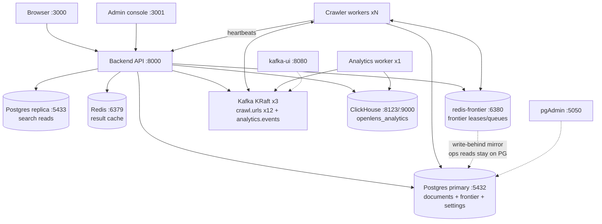
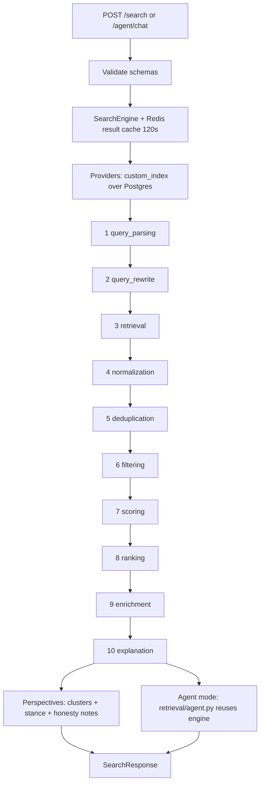
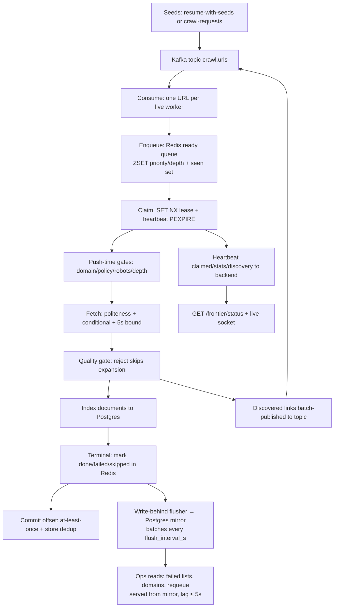
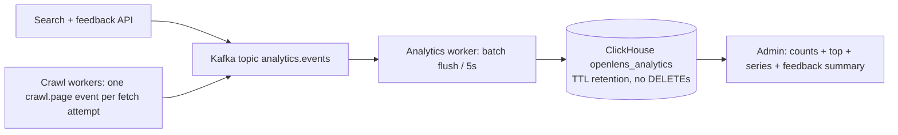

# Architecture (developers)

## High-level design

Four views: system context, search path, crawl path, analytics
path. Service ports are the `deploy/local` defaults; the crawler
count assumes `--scale crawler=6` against 12 `crawl.urls`
partitions.

### System context

### Search path

### Crawl path

Hot path (`frontier.backend: redis`, default stays `postgres`):
claims, leases, heartbeats, and the ready queue live in
redis-frontier instead of per-URL Postgres round-trips; the flusher
mirrors terminal states, checkpoints, and settings to Postgres, so
every ops read above is served from the mirror with bounded
staleness. Rollback is flipping the flag back — leases TTL out and
Kafka redelivers anything in flight.

### Analytics path

### Data and infrastructure

| Service | Role | Ports | State |
|---|---|---|---|
| `backend` | FastAPI API + heartbeat registry + WS fan-out | 8000 | stateless |
| `frontend` / `admin-frontend` | nginx SPAs | 3000 / 3001 | stateless |
| `postgres` | documents, frontier, checkpoints, settings | 5432 | `pgdata` |
| `postgres-replica` | async search reads, primary fallback | 5433 | `replica-data` |
| `redis` | SearchEngine result cache (120 s TTL) | 6379 | ephemeral |
| `redis-frontier` | Frontier hot path (leases/queues, `noeviction`, AOF); ops reads stay on Postgres (mirror lag ≤ `flush_interval_s`) | 6380 | `redis-frontier-data` |
| `kafka-1/2/3` | KRaft brokers, `crawl.urls` x12, `analytics.events` | 9092/9094/9095, internal 19092 | `kafka-data-*` |
| `crawler` xN | drain + fetch + index + heartbeat | — | store-backed resume |
| `analytics-worker` | topic-to-ClickHouse batch sink | — | offsets in Kafka |
| `clickhouse` | append-only analytics, TTL expiry | 8123 / 9000 | `clickhouse-data` |
| `pgadmin` / `kafka-ui` | ops inspection | 5050 / 8080 | stateless |

Cross-cutting rules: mandatory pipeline plugins fail closed;
reporting and fan-out fail open (a down broker stalls, never
crash-loops). Claimed rows carry owner leases (120 s TTL); offsets
commit only after index. Drains are time-boxed under 1/4 of
`max_poll_interval_ms` so a busy consumer is never mistaken for a
dead one. Kafka lag without members means nobody has polled yet —
watch heartbeats and `queue_depth`, not the member count
([troubleshoot](../troubleshoots/2026-11-02-kafka-group-fewer-members-than-crawlers.md)).

Deep dives: [Search Path](Search-Path) (stages, providers, ranking,
agent mode) and [Crawl Path](Crawl-Path) (frontier, fetch pipeline,
retry budget).

## Request path

`POST /api/v1/search` → validate (`api/schemas.py`) → `SearchEngine`
(`core/engine.py`) → provider retrieval → 10-stage pipeline
(`core/pipeline.py`) → ranker → explanations → response assembly →
`SearchResponseSchema.from_core`. Agent mode (`mode="agent"`) and
`POST /api/v1/agent/chat` branch into `retrieval/agent.py`, which
reuses the same in-process engine as its only search tool.

## Plugin pipeline

`core/interfaces.py` owns the stable shapes; `core/context.py` the
per-request state. Plugins declare stage, type, dependencies, and
whether they are **mandatory** (fail closed — unfiltered results
never render) or **optional** (failures isolated into diagnostics).
Ranking profiles (`configs/ranking.yaml`) are per-mode and validated
at startup.

## Index and storage

`custom_index` provider over Postgres (`storage.postgres`), with
SQLite for offline/tests and a MySQL extra. Documents carry metadata
JSON plus promoted columns. Drivers lazy-import; missing drivers
raise `ProviderError(UNAVAILABLE)`, never raw import errors.

## Perspectives (neutrality track)

- `retrieval/story_clusters.py` — pure title-overlap clustering
  (Jaccard + subject veto + time window), no I/O, no model.
- `retrieval/stance.py` — model-first stance judge with a
  deterministic keyword fallback; never raises.
- `retrieval/perspectives.py` — assembles the wire block from the
  ranked page (pipeline `story_id` first, clusterer for orphans),
  plus honesty notes (missing sides, trust caveats) and the
  extractive fallback answer.
- The search pipeline's `news-reranker` still owns ranking signals
  and internal `story_groups`; the API block never exposes it.

## Frontend contract

Backend `openapi.json` snapshots are checked in per app; orval
regenerates `src/api/generated/`. Hand-mirrored `api/types.ts` plus
runtime guards (`api/guard.ts`) degrade malformed fields to absent.
