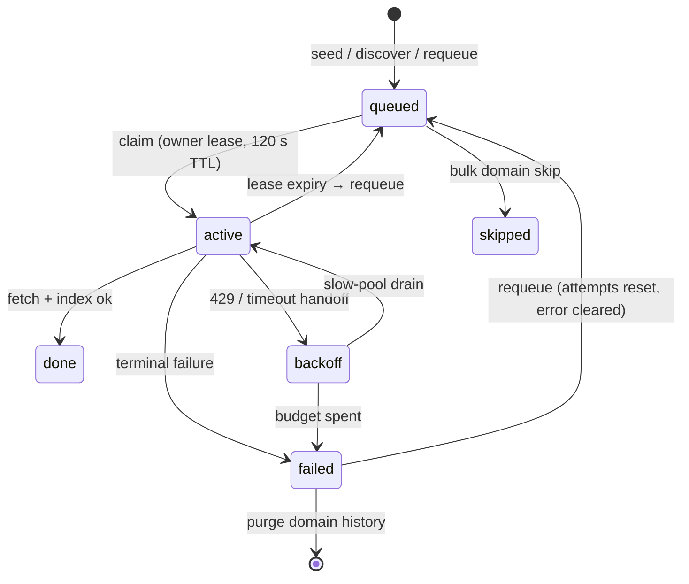

# Crawler and Frontier Ops (developers)

## Queue model

Postgres `frontier_queue` is the source of truth; the admin page
(`Queue`, port `3001`) shows queued/active rows with depth and
priority. Seeds enter via resume-with-seeds (optional per-call
`priority`; higher dequeues first, `ORDER BY priority DESC, depth
ASC`); discovered links inherit decayed priority (5 → 4 → 3 → 2 …)
and same-domain scope. Claimed rows carry an owner lease
(`frontier.lease_ttl_s`, heartbeat every TTL/3); only expired
leases are requeued.



## Redis hot path: staleness SLA (developers)

With `frontier.backend=redis` (default stays `postgres`), crawlers
claim/complete URLs against the `redis-frontier` compose service
(leases/queues, AOF `everysec`, `noeviction` — leases must never be
evicted), while **every ops read stays on Postgres**:

- `/frontier/failed*`, `/frontier/queued/domains`, `/frontier/status`,
  and auto-triage serve the Postgres **mirror**, never the hot path.
  No route changes: the API read store is already the
  `storage:`-keyed store.
- A write-behind flusher (`FrontierMirrorFlusher`, one per worker)
  drains buffered terminal transitions + discovery inserts to the
  mirror every `frontier.redis.flush_interval_s` (default **5 s**),
  plus a final drain on worker shutdown. **Staleness bound: every ops
  read lags the hot path by at most `flush_interval_s`.**
- Observe it with the `frontier_mirror_lag_seconds` gauge
  (`now − last successful flush`); alert when it exceeds
  `flush_interval_s`. A failed pass retries at-least-once, so the
  gauge — not error logs — is the divergence signal.
- Requeue/purge/skip mutations land on the mirror directly and
  converge on the next flush cycle; terminal states replay in order
  (enqueue first), so attempt counts match exactly.
- Rollback: flip `frontier.backend` back to `postgres` (leases TTL
  out of Redis; Kafka redelivers in-flight URLs, and the Postgres
  seen-set dedupes them).

## Discovery and freshness

- Sitemap/RSS discovery feeds per domain config, run on an
  interval with warn-level per-feed logs and worker-carried
  summaries (`last_discovery` on status).
- Requeue stale rows for age refresh; feeds catch new URLs.
  Daily full recrawls are unnecessary.

## Distributed mode

With `kafka.enabled`, seeds and discoveries flow through topic
`crawl.urls`; every `crawler` replica joins group `crawlers`, so
Kafka assigns each URL once (`--scale crawler=N`). Offsets commit
only after crawl + index; the Postgres seen-set dedupes twins.
`POST /api/v1/frontier/clear` pauses, deletes queued rows, and
purges the topic so published messages cannot refill the queue.

Members join the group on the **first poll**, which runs only after
the initial store-backlog drain (`_drain_once`). Zero members during
a deep drain is expected; flapping membership afterwards means a
drain outran `max_poll_interval_ms` (900 s) and the broker kicked
the member mid-drain. Watch heartbeats + `queue_depth`, not the
member count — see
[`kafka-group-fewer-members-than-crawlers`](../troubleshoots/kafka-group-fewer-members-than-crawlers.md).

## Fetch outcomes, retries, and trap defense

Each claim costs at most 3 fetch attempts (`max_attempts_per_url`;
retries surface across `crawl()` calls, one fetch per URL per call):

- **Terminal on first hit:** any 4xx, `invalid url`
  (non-http(s) scheme, hostless URL, archive-wrapped `mailto:`),
  empty fetch, content-type/quality skips. No requeue.
- **Slow-retried (backoff pool):** 429 and fetch timeouts are parked
  as `backoff` rows and handed to the `crawl.backoff` topic instead
  of requeueing into the fast lane — the main drain never waits them
  out. Two slow workers retry with 10 s politeness and 30 s timeouts.
- **Retried in place:** 5xx and transport errors requeue with the
  normal politeness (retry-soon is correct for server errors).
- Every attempt emits one `crawl.page` analytics event, so the
  admin Crawler card counts *attempts*, not URLs.

Quality-skipped pages never expand outlinks, and junk nav never
leaves extraction — but hosts with thousands of near-empty pages
(demo farms, doc mirrors) still burn one fetch each. Bound them
with `domain_policies` (`configs/default.yaml`): `max_pages` caps
fetches per domain per run, `rate_limit_s` spaces hits (arxiv.org
ships at 3.0 s), `max_depth` caps link-following, `allow: false`
cuts the host entirely. For never-succeed hosts (bot-wall 401s,
tarpitted timeouts) prefer `deny_domains`/tight budgets over
repeated full-price failures.

## Failed-domain operations

`GET /frontier/failed/domains` rolls failed rows up by host with
per-host counts and the most common reason each (paginated, open
read). Each row offers four admin-only actions, all fail-closed on
malformed host lists:

- **Requeue** (`POST /frontier/domains/requeue`) — failed rows back
  to queued with attempts reset and the error cleared (reseed
  semantics), so the host actually refetches.
- **Flush** (`POST /frontier/domains/purge`) — deletes the host's
  failed history only; queued/active/done rows are untouched.
  Confirm in the UI: irreversible.
- **Skip** (`POST /frontier/domains/skip`) — marks the host's queued
  rows skipped with a naming `last_error`.
- **Block** — no endpoint: the admin UI reads the `indexing` config
  doc, merges the host into `deny_domains` (deduped, lowercased),
  and PUTs it back. Policy gates apply on the next claim; workers
  pick the config up on refresh.
- **Auto-triage** (`POST /frontier/failed/domains/auto-triage`,
  admin-only, optional `{"dry_run": true}`) — one pass over every
  failed host: robots/content-type/404/401 → skip+purge, 429 →
  requeue + volume-scaled politeness wait + persistent `rate_limit_s`
  (`5s` per failed row, `30s` max, never loosened on later passes),
  fetch timeout → requeue + backoff + priority sink + the same
  persistent `rate_limit_s`, thin content → skip+block+purge.
  Unknown reasons and the `(invalid)` bucket stay untouched and are
  reported. Use dry-run first on a new backlog.

## Scaling crawler throughput

Each worker fetches pages sequentially, so per-worker rate is ~1 page
per (fetch + politeness wait + index writes). Scale in this order:

1. **Replicas** (no code change): `--scale crawler=N`, up to **24**
   (one per `crawl.urls` partition; more replicas idle). On the
   release host this is `CRAWLER_SCALE` in `release.env`. Watch
   `kafka_lag_total` first — scale only when lag grows. The backoff
   pool scales separately via `CRAWLER_BACKOFF_SCALE` (default 2;
   backoff volume is a fraction of intake, so it stays small).
2. **Per-poll budget** (config): `kafka.max_pages_per_poll`
   (default 25) amortizes poll/commit overhead. Keep worst-case poll
   work under ~1/4 of `kafka.max_poll_interval_ms` (900s); past that
   the broker mistakes a busy consumer for a dead one and rebalances.
3. **Link fan-out** is already batched: one broker flush per drain,
   not one round-trip per link.

**Connection math** (Postgres is the ceiling): each process holds ~2
pools × `OPENLENS_PG_POOL_SIZE` (default 5 → ~10 server connections);
the backend holds one more pool on the replica when it is enabled.
Provision
`(replicas + 1) × 2 × pool_size + headroom` via
`POSTGRES_MAX_CONNECTIONS` (compose default 400 — covers 24 main
replicas + the backoff pool + backend at pool 5). We hit
`sorry, too many clients` before this knob existed; do not scale
replicas without it. Lowering pool size helps only past this; a
sequential worker rarely needs 5 concurrent connections. The writer
itself runs at 2G/4 CPU with 512MB `shared_buffers` (see compose)
after the 24-worker scale-out doubled its checkpoint and connection
load.

While scaling, watch PG CPU/IO and `pg_stat_activity` wait events —
every page costs upserts plus index maintenance, and search latency
(`custom_index` provider time) degrades if the DB saturates.

## Worker throughput diagnostics

Each heartbeat carries cumulative intake counters (`pages`, `tokens`,
`errors` with an `at` timestamp); the API keeps the last two samples
per worker and serves per-worker `pages_per_min` / `tokens_per_min`
plus the totals in `GET /api/v1/frontier/workers` and the status
payload. The admin Workers section shows a cluster aggregate
(rate + cumulative totals) and a per-worker breakdown. Tokens are
whitespace-separated words of extracted indexable text — the same
unit the indexer stores. Rates are null until two samples arrive;
stat-less beats from older workers neither break the registry nor
reset the baseline.

## Ops checklist

- Size Postgres `max_connections` for ~10 per process × workers.
- Watch consumer lag (status `kafka_lag_total`) before scaling.
- `scripts/cleanup.sh` wipes indexed + queue data for a fresh crawl.
- Incidents and fixes: `docs/troubleshoots/`.

## Category backfill (`scripts/backfill_site_categories.py`)

Re-tags already-indexed rows under the current classifier without
refetching: it pages stored URL+metadata through
`classify_site_category` and rewrites only stale rows (wrong or
missing `site_category`, outdated `CATEGORY_RULES_VERSION`).

**When to run it** — after any classifier change ships: a new
category in `configs/category_domains.yaml`, a retuned
`classify_site_category` branch, or a `CATEGORY_RULES_VERSION`
bump. New crawls classify at extraction, so only pre-existing rows
need it. Safe to run live (500-row pages, row-level rewrites) and
idempotent — re-running rewrites zero rows.

**When NOT to run it** — it cannot add `description`, `date_modified`,
`geo_hint`, or chrome-free content; those need a recrawl (raw HTML
is never stored). It also never deletes or requeues URLs.

**Steps** (release host; the script resolves `src/` itself, but the
system python has no project deps — run it where the backend
environment exists):

```bash
cd ~/servers/openlens-release
BE=$(docker ps --format '{{.Names}}' | grep -i backend | head -1)
docker cp scripts/backfill_site_categories.py "$BE:/tmp/backfill_site_categories.py"
docker exec "$BE" python3 /tmp/backfill_site_categories.py
```

Expected output: `backfill done: <rewritten> rewritten of <total> documents`.

**Verify** with a category census (same host):

```bash
PGCONT=$(docker ps --format '{{.Names}}' | grep -i postgres | head -1)
docker exec -i "$PGCONT" psql -U openlens -d openlens -t -c \
  "SELECT metadata->>'site_category', COUNT(*) FROM public.documents GROUP BY 1 ORDER BY 2 DESC;"
```

Host-venv alternative (only when the checkout has its own `.venv`
with the project installed): `source .venv/bin/activate`, then
`python3 scripts/backfill_site_categories.py` from the repo root.
