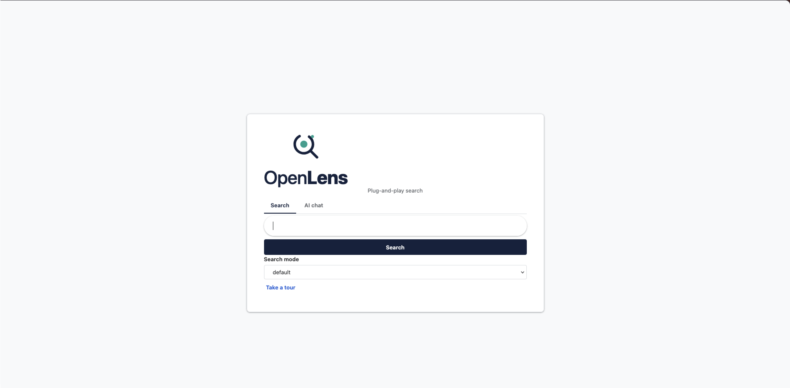
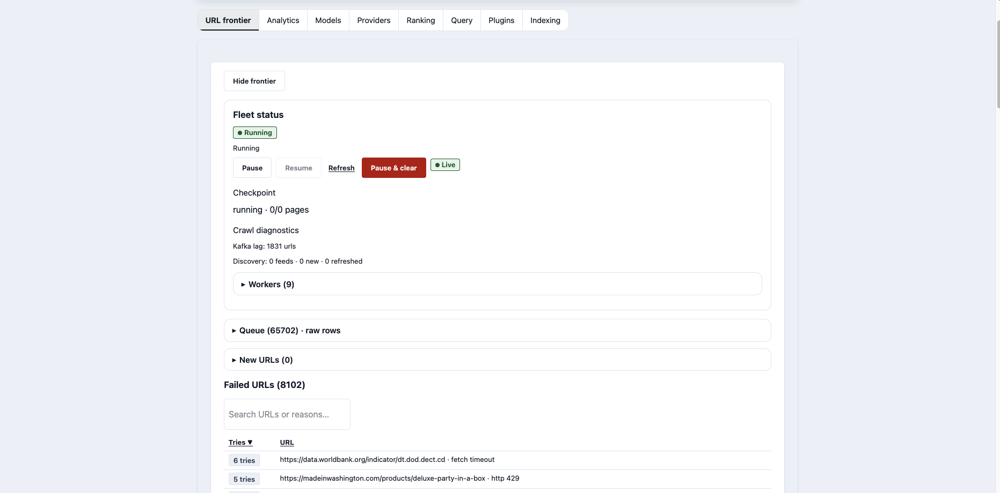
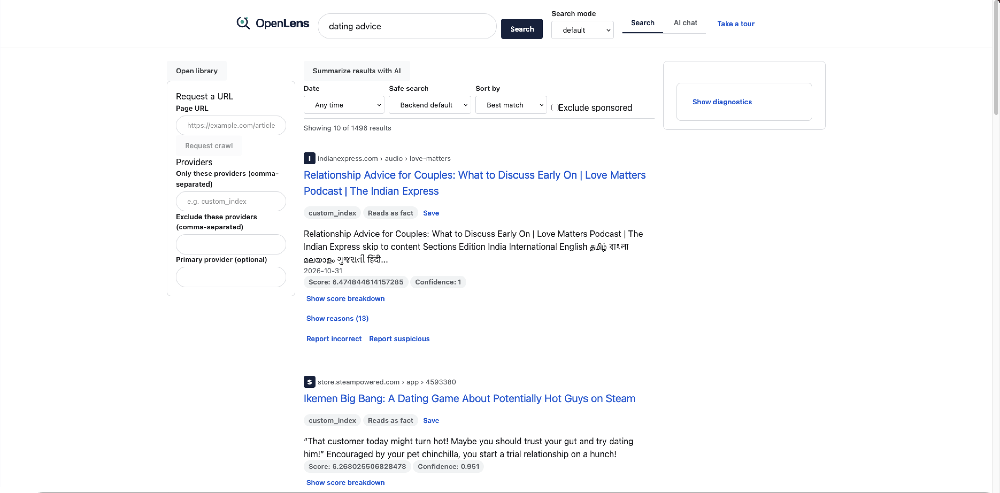
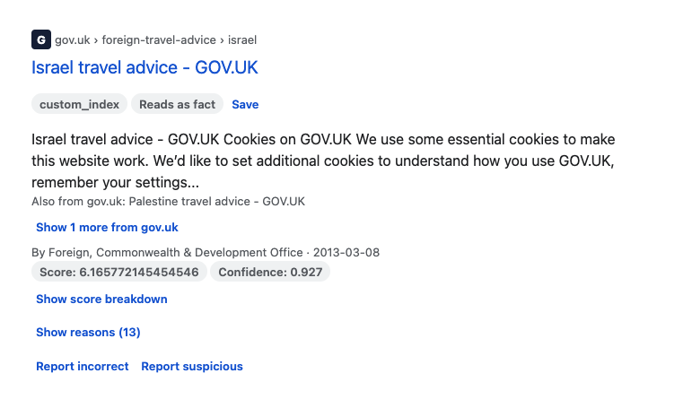
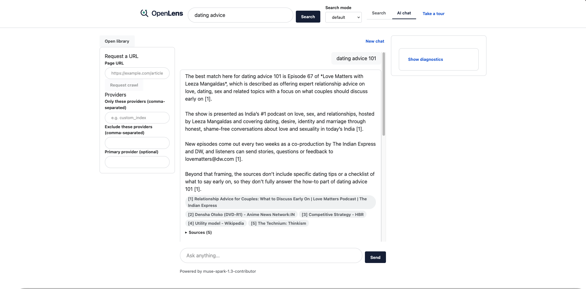
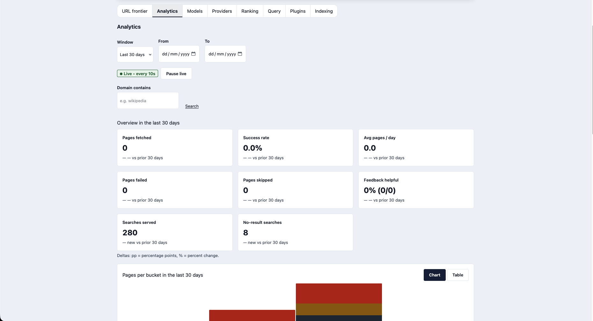
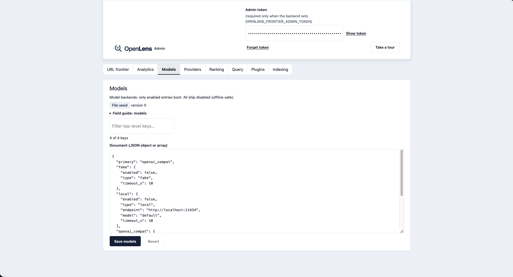

# Search and Admin Guide

Step-by-step use of the search page and the admin dashboard. Setup
(shown with ports) lives in [Frontend Setup](Frontend-Setup); this
page assumes both apps are running: search on port `3000`, admin on
port `5174` in dev (`3001` on the compose stack).

## Part 1 — Search

### 1. Run your first search

1. Open the search page. The landing shows the brand, **Search** /
   **AI chat** tabs, the query box, a **Search mode** select, and a
   **Take a tour** button.
2. Type in the big box. Suggestions appear while you type when the
   deployment enables them; otherwise the form simply stays quiet
   and submits what you typed.
3. Pick a mode when you need one (`default` is general web;
   `child-safe`, `news`, `shopping`, `travel`, `events`, `tech`,
   `software`, `health` narrow the index, `agent` reasons harder).
4. Press **Search** (or Enter). The page flips to the workspace:
   the query docks into a sticky header so you can refine without
   losing your place.

New here? Press **Take a tour** instead of reading on: the tour
walks the same flow and offers to run an example search, open AI
chat, and ask an example question for you.

### 2. Read the results page

- **Sidebar (left on wide screens):** provider filters
  (include/exclude, preferred provider), a filters on/off switch,
  and your **Library** — saved results and recent searches. The
  library never leaves your browser.
- **Results (center):** every card shows the domain tile, title,
  provider/provenance badges, and snippet. Depending on the hit you
  also get key claims, a confidence signal, the additive scoring
  breakdown, plain-language rank reasons, and warnings. Same-domain
  hits collapse behind a group toggle — expand it instead of paging
  through duplicates.
- **Something off?** The per-card report button sends anonymous
  feedback (no profile, no tracking) that feeds future ranking.

- **AI summary (top):** a cited short version of the top hits when a
  model is configured; silence otherwise, never fiction.
- **Diagnostics rail (right, dev builds):** the pipeline stages,
  plugin executions with latencies, and the exact path your query
  took — the first place to look when a result surprises you.
- **Pagination** sits under the list; a polite announcer speaks the
  result count to screen readers.

### 3. Ask in AI chat

1. Switch to the **AI chat** tab (header, next to Search).
2. Ask in plain language. The model searches your index through
   budgeted tools and answers **with citations** — chips that open
   the source result in a new tab.
3. Open the **trace** to see the rewritten query, model calls,
   filters, and fallbacks, step by step.
4. If chat can't help, the fallback button runs your message as a
   standard search and drops you back on results.
5. **New chat** starts over. Transcripts persist in your browser
   only; reloading keeps them, clearing site data removes them.

Tips: the mic button dictates into the query box; suggestions (when
on) move with ArrowDown/ArrowUp, complete with Enter, dismiss with
Escape. Blank or over-long queries are rejected inline with a
message — nothing is sent.

## Part 2 — Admin

### 4. Unlock the dashboard

1. Open the admin page. Everything reads fine without a token, but
   mutations (pause, seeds, triage, config saves) need one.
2. Paste the `OPENLENS_FRONTIER_ADMIN_TOKEN` value into the token
   bar. It is stored in your browser only and sent as the admin
   header; a wrong or missing token fails closed with `403`.
3. Pick a section from the tab row (keyboard: arrows move, Home/End
   jump): **URL frontier**, **Analytics**, then one tab per config
   file (**Models**, **Providers**, **Ranking**, **Query**,
   **Plugins**, **Indexing**).

### 5. Run the URL frontier

- **Status first:** pause/resume the crawl, watch queue depth and
  the checkpoint. The queue streams live over a socket; **Refresh**
  re-polls on demand, and if the feed drops a toast says so while
  the last snapshot stays on screen.
- **Grow the index:** paste seed URLs (optional priority) and
  enqueue; inspect any URL for its frontier record.
- **Clear failures:** the failed-domains board groups by domain with
  top reasons. Run **auto-triage** (dry-run first) to propose
  per-domain dispositions — skip-list, requeue, or purge — then
  apply. Never purge an unknown host: it gets rediscovered.
- **Fleet:** the workers table shows who heartbeated recently and
  what they claimed.

### 6. Read Analytics

1. Choose a window preset or set **From/To** for an absolute range;
   the note under the controls tells you which is in play.
2. **KPI cards** headline the window with prior-period deltas
   (fetched, success rate, pace, failed, skipped, feedback,
   searches, no-result share).
3. **Throughput** stacks fetched/failed/skipped per bucket (hourly
   on short windows, daily otherwise); flip to the table view for
   exact numbers.
4. Ranked lists show crawl domains, failing domains with reasons,
   and outcome splits — all searchable, sortable, with jump paging
   on the long ones. **Search traffic** covers served searches,
   no-result share, and per-mode splits.
5. The **Live** badge streams fresh counts/series every few seconds
   (cadence is server-tunable; the badge shows the actual interval).
   **Pause live** freezes the feed — closing or hiding the tab
   pauses it automatically. Tops and ranked lists refresh on input,
   not on the socket.

### 7. Edit configuration

Each config tab shows the effective document with a helper guide
beside the editor. Editing rules are uniform: unknown keys are
rejected, values are validated on save, and errors name the exact
field. Notes per section:

- **Models / Providers:** only enabled entries boot; most ship
  disabled for offline safety.
- **Ranking:** profiles keyed by search mode; weights must be
  finite numbers.
- **Query:** normalizer, intent, expansion, and context sections.
- **Plugins:** per-plugin validation applies on save.
- **Indexing:** timeouts, politeness, page caps, depth. Changes
  take effect on worker restart.

## Refreshing the screenshots

Captures live under `docs/wiki/assets/`, embedded in the steps
above. To retake one: reproduce the state, screenshot, and save
over the same filename. Still missing: `admin-config.png` — a
config tab with the helper guide beside the editor; add the embed
under step 7 once captured.
