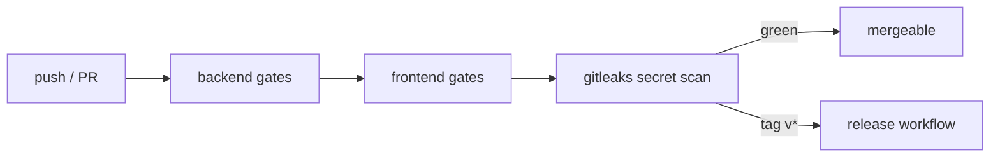

# Testing and CI (developers)

## Backend

```bash
UV_CACHE_DIR=/tmp/uv-cache uv run pytest tests -q
UV_CACHE_DIR=/tmp/uv-cache uv run ruff check src tests
UV_CACHE_DIR=/tmp/uv-cache uv run ruff format --check src tests
UV_CACHE_DIR=/tmp/uv-cache uv run mypy src
UV_CACHE_DIR=/tmp/uv-cache uv run pip-audit --progress-spinner=off
```

Offline only: no network, keys, or clusters — providers and models
are fakes. A pinned failing test is a contract: change the
expectation only when the task explicitly changes it.

## Frontend (per app)

`npm run lint` · `npm run format:check` · `npm test` ·
`npm run build` · `npm audit --omit=dev`.

## CI (`.github/workflows/ci.yml`)



Runs on every push/PR: backend gates, frontend gates, then a
full-history gitleaks secret scan. CI never deploys — only a `v*`
tag triggers the [release workflow](Release-Process).
